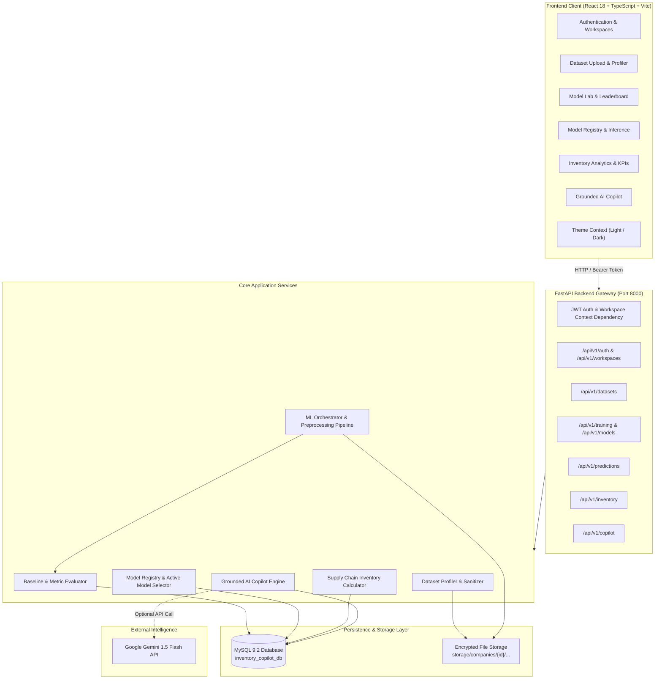

# AI Powered Inventory Management and Intelligence Copilot

> **Multi-tenant AI-powered inventory management, machine learning, demand forecasting, and decision intelligence.**

[](https://www.python.org/)
[](https://fastapi.tiangolo.com/)
[](https://react.dev/)
[](https://www.typescriptlang.org/)
[](https://vitejs.dev/)
[](https://tailwindcss.com/)
[](https://www.mysql.com/)
[](https://scikit-learn.org/)
[](https://xgboost.readthedocs.io/)
[](https://docs.pytest.org/)

---

## 📋 Table of Contents

1. [Executive Summary & Problem Statement](#1-executive-summary--problem-statement)
2. [Key Capabilities & Features](#2-key-capabilities--features)
3. [Technology Stack](#3-technology-stack)
4. [System Architecture & Data Flow](#4-system-architecture--data-flow)
5. [Prerequisites](#5-prerequisites)
6. [Environment Setup & Configuration](#6-environment-setup--configuration)
7. [Database Setup & Alembic Migrations](#7-database-setup--alembic-migrations)
8. [Application Startup Guide](#8-application-startup-guide)
9. [Automated Verification & Test Execution](#9-automated-verification--test-execution)
10. [Interactive API Documentation](#10-interactive-api-documentation)
11. [Enterprise Multi-Tenant Security & RBAC](#11-enterprise-multi-tenant-security--rbac)
12. [Machine Learning Engine & Evaluation Metrics](#12-machine-learning-engine--evaluation-metrics)
13. [Inventory Intelligence & Optimization Formulas](#13-inventory-intelligence--optimization-formulas)
14. [Roadmap & Contributing](#14-roadmap--contributing)

---

## 1. Executive Summary & Problem Statement

Modern retail, wholesale, and e-commerce enterprises face severe operational vulnerabilities stemming from fragmented inventory tracking, erratic demand fluctuations, stockouts, overstock holding costs, and siloed data analysis. Traditional Enterprise Resource Planning (ERP) tools and static spreadsheets fail to provide real-time, predictive decision support, leaving supply chain operators with costly blind spots.

**AI Powered Inventory Management and Intelligence Copilot** is a production-engineered, multi-tenant enterprise intelligence platform that bridges operational data ingestion with cutting-edge machine learning and conversational artificial intelligence. It empowers organizations to:

- **Ingest & Profile Datasets Automatically**: Diagnose data hygiene, detect missing values, calculate data health scores, and configure machine learning targets dynamically.
- **Train & Compare Machine Learning Models**: Automate candidate model training across demand forecasting, stockout classification, cost regression, and anomaly detection with baseline-first rigor.
- **Promote Champion Models**: Deploy winning algorithms to an active Model Registry for sub-second real-time inference and high-throughput batch scoring.
- **Compute Supply Chain KPIs**: Calculate Safety Stock ($SS$), Reorder Point ($ROP$), Days of Supply ($DOS$), and Economic Order Quantity ($EOQ$).
- **Converse with a Grounded AI Copilot**: Consult an AI assistant grounded strictly in live tenant datasets, champion models, and inventory health metrics, powered by Google Gemini with a deterministic fallback engine.
- **Collaborate with Role-Based Security**: Manage teams with Owner/Worker isolation, worker self-registration, and owner approval gates.

---

## 2. Key Capabilities & Features

### 🏢 Multi-Tenant Workspaces & RBAC
- **Tenant Isolation**: Every database record, dataset, trained model binary, and prediction is strictly segmented by `company_id`.
- **Role-Based Access Control**:
  - `OWNER`: Full administrative privileges, dataset management, model training, champion promotion, worker provisioning, and join request approval.
  - `WORKER`: Operational access to view datasets, run model predictions, inspect inventory analytics, and query the AI Copilot.

### 👥 Worker Onboarding & Approval Workflow
- **Owner Direct Provisioning**: Workspace owners can create and provision worker accounts directly from the Team Management console.
- **Worker Self-Registration**: New team members can register an account, choose an existing company workspace from an autocomplete dropdown, and submit a pending join request.
- **Owner Approval Barrier**: Worker accounts remain locked in `PENDING` status until an authorized workspace owner reviews and approves the request. Rejected requests are securely denied.
- **Dynamic Sidebar Badge**: Real-time pending request count notification badge in the owner's sidebar navigation.

### 📊 Dataset Ingestion & Automated Data Quality Profiling
- **Format Support**: High-performance streaming upload of CSV and Microsoft Excel (`.xlsx`) files up to 50MB.
- **Automated Health Profiling**:
  - Health score calculation (0–100%).
  - Semantic column data type detection (numeric, categorical, datetime, text).
  - Missing value detection, duplicate row analysis, and constant column alerts.
  - Value cardinality, statistical distribution summaries, and class imbalance metrics.
- **Dynamic Column Configuration Wizard**:
  - Map target columns, predictor features, time-series date columns, and grouping entities (SKU, Warehouse).
  - Built-in validation prevents date column overlap with regular feature predictors.
  - Modal rendering via React portals with keyboard escape listeners and backdrop lock.

### 🧠 End-to-End Machine Learning Engine
- **Four Dedicated ML Tasks**:
  1. **Demand Forecasting**: Chronological time-series split (zero lookahead leakage), group-aware lag generation, rolling statistics, and models: Naive Baseline, Seasonal Naive, Supervised Lag Random Forest, and Supervised Lag XGBoost.
  2. **Stockout Risk Classification**: Imbalance handling (`class_weight="balanced"` / `scale_pos_weight`), Stratified validation, Dummy Classifier baseline, Logistic Regression, Random Forest Classifier, and XGBoost Classifier.
  3. **Inventory Value & Cost Regression**: Median Baseline, Ridge Regression, Random Forest Regressor, and XGBoost Regressor.
  4. **Anomaly & Contamination Detection**: Isolation Forest with automated contamination tuning, anomaly scores, and outlier flags.
- **Baseline-First Benchmark Rigor**: Every candidate run trains an appropriate baseline (Median, Dummy, Naive) to establish authentic predictive lift before recommending complex models.

### 🔬 Graphical Model Lab & Leaderboard
- **Ranked Leaderboard**: Models ranked automatically by primary metric ($R^2$, RMSE, F1-Score, or ROC-AUC).
- **Interactive Visualizations**: Side-by-side metric comparison bar charts, validation actual vs. predicted curves, and feature importance rankings powered by Recharts.
- **Training Artifacts & Logs**: Detailed logs, confusion matrix summaries, class distribution metrics, and model hyperparameter persistence.

### 📦 Model Registry & Prediction Engine
- **Champion / Challenger Promotion**: Promote any candidate model to `ACTIVE` production status with a single click.
- **Interactive Single-Record Inference**: Dynamically renders input fields based on the champion model's feature schema with instant latency tracking.
- **High-Throughput Batch Predictions**: Upload a CSV of unseen inventory records to receive enriched predictions for instant download.

### 📈 Inventory Intelligence & Optimization
- **Safety Stock ($SS$)**: Calculated using standard deviation of demand and supplier lead times across 90%, 95%, and 99% confidence intervals.
- **Reorder Point ($ROP$)**: Dynamic computation combining expected lead time demand and safety buffers.
- **Days of Supply ($DOS$)**: Real-time burn-rate analysis flagging inventory into `CRITICAL`, `REORDER_NOW`, `HEALTHY`, and `OVERSTOCK`.
- **Trapped Capital & Shrinkage**: Valuation of excess stock and potential carrying cost reductions.

### 🤖 Grounded AI Copilot
- **Dual-Engine Architecture**:
  - **Google Gemini 1.5 Flash**: Contextual natural language generation strictly grounded in live workspace datasets, active model metrics, and inventory health KPIs.
  - **Deterministic Intelligence Fallback**: Supply chain rule engine answering stockout queries, reorder points, and model accuracy benchmarks when an LLM API key is absent.

### 🌓 Global Theme Switcher
- Persistent Light and Dark theme switching powered by Tailwind CSS design tokens and localized React state.
- Cohesive styling across navigation, sidebars, charts, data tables, dialogs, and modals.

---

## 3. Technology Stack

```
AI Powered Inventory Management and Intelligence Copilot
├── Backend Architecture
│   ├── Python 3.11+
│   ├── FastAPI (RESTful API, Async, OpenAPI 3.0)
│   ├── Pydantic v2 (Data Validation & Settings Management)
│   ├── SQLAlchemy 2.0 (ORM & Type-Safe Database Queries)
│   ├── Alembic (Relational Database Migrations)
│   ├── Scikit-Learn 1.5.2 & XGBoost 2.1.2 (Machine Learning Pipelines)
│   ├── Pandas 2.2 & NumPy 2.1 (Data Manipulation & Feature Engineering)
│   └── PyJWT & Passlib / Bcrypt (Authentication & Security)
├── Relational Database
│   ├── MySQL 9.2 (Production & Development Instance on Port 3307)
│   └── SQLite In-Memory (Automated Pytest Isolation Suite)
├── Frontend Architecture
│   ├── React 18.3 (Component-Driven Single Page Application)
│   ├── TypeScript 5.5 (Strict Typing & Interface Contracts)
│   ├── Vite 5.4 (Next-Generation Frontend Tooling & Fast HMR)
│   ├── Tailwind CSS 3.4 (Utility-First Styling & Dark Mode Tokens)
│   ├── Recharts 2.12 (Declarative Responsive Data Visualization)
│   ├── Lucide React (Accessible Vector Iconography)
│   └── Axios (HTTP Client with Tenant Header Interceptors)
└── Generative AI & Decision Support
    ├── Google Gemini API (gemini-1.5-flash)
    └── Deterministic Domain-Specific Supply Chain Expert Engine
```

---

## 4. System Architecture & Data Flow



---

## 5. Prerequisites

Before installing the project, verify that your host environment meets the following specifications:

- **Operating System**: Windows 10/11, macOS 12+, or Ubuntu Linux 20.04+.
- **Python**: Version `3.11` or higher (`python --version`).
- **Node.js**: Version `18.0.0` or higher (`node --version`) with `npm 9+`.
- **MySQL Database**: MySQL `8.0` or `9.x` installed and running. Default development configuration connects to `127.0.0.1:3307`.
- **Git**: Version `2.30+` for version control management.

---

## 6. Environment Setup & Configuration

### Repository Clone & Directory Structure
```bash
git clone https://github.com/<your-username>/ai-powered-inventory-management-intelligence-copilot.git
cd ai-powered-inventory-management-intelligence-copilot
```

### Backend Configuration
Navigate to the `backend/` directory and create your local environment file:

```bash
cd backend
cp .env.example .env
```

Edit `backend/.env` with your preferred credentials:

| Variable | Description | Default / Example Value |
|---|---|---|
| `APP_NAME` | Display application title | `"AI Powered Inventory Management and Intelligence Copilot"` |
| `APP_ENV` | Application environment (`development` / `production`) | `development` |
| `API_V1_STR` | Base API routing prefix | `/api/v1` |
| `SECRET_KEY` | Cryptographic secret for signing JWT tokens (min 32 chars) | `your-secure-random-32-character-secret-key-here` |
| `ALGORITHM` | JWT token encryption algorithm | `HS256` |
| `ACCESS_TOKEN_EXPIRE_MINUTES` | Session validity duration | `1440` (24 hours) |
| `DB_HOST` | MySQL hostname or IP address | `127.0.0.1` |
| `DB_PORT` | MySQL listening port | `3307` |
| `DB_USER` | MySQL database user | `root` |
| `DB_PASSWORD` | MySQL user password | `your_mysql_password` |
| `DB_NAME` | Database schema name | `inventory_copilot_db` |
| `STORAGE_DIR` | Relative path for secure dataset and model storage | `storage` |
| `GEMINI_API_KEY` | *(Optional)* Google Gemini API key for LLM responses | `AIzaSy...` *(Leave blank for deterministic engine)* |
| `CORS_ORIGINS` | Whitelisted frontend origins | `["http://localhost:5173","http://127.0.0.1:5173"]` |

---

## 7. Database Setup & Alembic Migrations

Ensure your MySQL service is active on your configured port (e.g. `3307`). Create the application database:

```sql
CREATE DATABASE IF NOT EXISTS inventory_copilot_db CHARACTER SET utf8mb4 COLLATE utf8mb4_unicode_ci;
```

Apply all versioned Alembic database migrations from the `backend/` directory:

```bash
# Activate your Python virtual environment first
# On Windows PowerShell:
.\.venv\Scripts\activate

# On Linux / macOS:
source .venv/bin/activate

# Execute migrations to latest revision
alembic upgrade head
```

To verify that the migrations succeeded:
```bash
alembic current
```

---

## 8. Application Startup Guide

### 1. Launching the Backend API Server
From the `backend/` directory with the virtual environment activated:

```bash
uvicorn app.main:app --host 127.0.0.1 --port 8000 --reload
```
The FastAPI server will initialize and begin listening on `http://127.0.0.1:8000`.

### 2. Launching the Frontend Development Server
Open a separate terminal, navigate to the `frontend/` directory, install packages, and start Vite:

```bash
cd frontend
npm install
npm run dev
```
The frontend Single Page Application will be available at `http://127.0.0.1:5173` (or `http://localhost:5173`).

---

## 9. Automated Verification & Test Execution

The codebase contains a comprehensive automated test suite verifying authentication, tenant isolation, dataset ingestion, ML model training, evaluation metrics, and API endpoints.

### Executing Backend Pytest Suite
Run the full test suite using the isolated SQLite in-memory runner:

```bash
cd backend
python -m pytest -v
```
**Expected Result**: All 106 unit and integration tests pass cleanly with zero regressions.

```text
============================== 106 passed in 14.85s ==============================
```

### Verifying Frontend Build & Type Safety
To execute strict TypeScript compilation and package the production bundle:

```bash
cd frontend
npm run build
```
**Expected Result**: Zero TypeScript errors, clean bundle compilation in `frontend/dist/`.

---

## 10. Interactive API Documentation

FastAPI automatically generates interactive, OpenAPI-compliant documentation accessible directly in your browser:

- **Swagger UI Interactive Explorer**: [`http://127.0.0.1:8000/docs`](http://127.0.0.1:8000/docs)
- **ReDoc Technical Specification**: [`http://127.0.0.1:8000/redoc`](http://127.0.0.1:8000/redoc)
- **OpenAPI Schema JSON**: [`http://127.0.0.1:8000/api/v1/openapi.json`](http://127.0.0.1:8000/api/v1/openapi.json)

---

## 11. Enterprise Multi-Tenant Security & RBAC

| Security Dimension | Implementation Standard |
|---|---|
| **Data Partitioning** | Hard database isolation where every query enforces `company_id = active_workspace.id`. |
| **Filesystem Security** | Isolated tenant directories (`storage/companies/<uuid>/...`) with path traversal guards. |
| **Authentication** | Passwords hashed using industry-standard Bcrypt. Authentication via stateless JWT Bearer tokens. |
| **Access Control (RBAC)** | Strict role distinction between `OWNER` (full administrative rights) and `WORKER` (operational read/inference rights). |
| **Worker Approval Gate** | Self-registered workers cannot access workspace data until explicitly approved by an owner. |
| **Cross-Tenant Guard** | Multi-company users cannot access or tamper with data belonging to other workspaces. |

---

## 12. Machine Learning Engine & Evaluation Metrics

The system implements a baseline-first evaluation methodology ensuring that model selection reflects true predictive utility rather than inflated metrics.

### Evaluation Metrics by Task Type

| Task | Primary Metric | Secondary Metrics | Supported Algorithms |
|---|---|---|---|
| **Demand Forecasting** | $R^2$ / RMSE | MAE, MAPE | Naive Baseline, Seasonal Naive, Supervised Lag Random Forest, Supervised Lag XGBoost |
| **Stockout Risk Classification** | Macro F1-Score | Accuracy, Precision, Recall, ROC-AUC | Dummy Baseline, Logistic Regression, Random Forest Classifier, XGBoost Classifier |
| **Inventory Value Regression** | $R^2$ / RMSE | MAE | Median Baseline, Ridge Regression, Random Forest Regressor, XGBoost Regressor |
| **Anomaly Detection** | Contamination Rate | Anomaly Score, Outlier Proportion | Isolation Forest |

---

## 13. Inventory Intelligence & Optimization Formulas

The inventory intelligence module provides mathematical formulations for supply chain optimization:

### 1. Safety Stock ($SS$)
$$SS = Z \times \sigma_d \times \sqrt{L}$$
Where:
- $Z$: Service factor corresponding to desired cycle service level ($Z = 1.65$ for 95%, $Z = 2.33$ for 99%).
- $\sigma_d$: Standard deviation of daily customer demand.
- $L$: Supplier replenishment lead time in days.

### 2. Reorder Point ($ROP$)
$$ROP = (\bar{d} \times L) + SS$$
Where:
- $\bar{d}$: Average daily demand rate.
- $L$: Replenishment lead time in days.
- $SS$: Computed safety stock buffer.

### 3. Days of Supply ($DOS$)
$$DOS = \frac{\text{Current On-Hand Stock}}{\bar{d}}$$

### 4. Economic Order Quantity ($EOQ$)
$$EOQ = \sqrt{\frac{2 \times D \times S}{H}}$$
Where:
- $D$: Annual demand quantity.
- $S$: Fixed ordering setup cost.
- $H$: Annual holding and carrying cost per unit.

---

## 14. Roadmap & Contributing

### Planned Enhancements
- [ ] Automated supplier purchase order generation and email dispatch.
- [ ] Webhook alerts for critical stockout thresholds via Slack and Microsoft Teams.
- [ ] Integration with ERP platforms (SAP, NetSuite, Shopify, QuickBooks).
- [ ] Multi-echelon inventory optimization across central warehouses and regional distribution hubs.

### Contributing
Contributions are welcome! Please follow these steps:
1. Fork the repository.
2. Create a descriptive feature branch (`git checkout -b feature/supply-chain-enhancement`).
3. Commit your changes adhering to conventional commits (`git commit -m "feat: add multi-echelon safety stock calculation"`).
4. Verify that all 106 backend tests and frontend build pass.
5. Push to the branch (`git push origin feature/supply-chain-enhancement`).
6. Open a detailed Pull Request.

---

## 📄 License

This project is licensed under the [MIT License](LICENSE).

---

*Engineered with precision for modern enterprise inventory intelligence and machine learning operations.*
